# HaloDock

A radial launcher for Windows that pops out of the edge of your screen. Rest your pointer against the left, right or top edge and your files, folders and apps fan out in a half-wheel. Scroll to turn it, click to open, drag to rearrange.

<p align="center">
  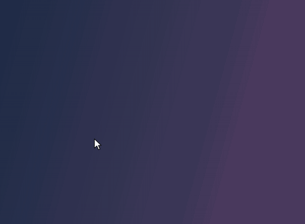
</p>

<p align="center"><a href="docs/demo.mp4">Watch the demo as a video</a></p>

## Features

- **Opens from the edge.** Rest the pointer on the left, right or top edge for a moment and the wheel opens right there. Move away and it tucks back in. The bottom is left to the taskbar.
- **Real Windows icons.** Every item shows the same icon Explorer would.
- **Scroll to turn.** The mouse wheel spins the ring and doesn't scroll the window underneath.
- **Rings.** Save several sets of items, each with its own colour. A column of coloured dots by the edge switches between them, with a ripple in the new ring's colour. Click a dot or scroll just inside the icons.
- **Arrange it like a phone home screen.** Long-press an icon to pick it up; the others slide apart to show where it'll land. Drop it on the unpin symbol in the middle to take it off the ring.
- **Drag and drop.** Drag files from Explorer into a gap to pin them to the ring. Drop them on a folder icon to move or copy them there (Explorer rules: Ctrl copies, Shift moves), or on an app to open them with it.
- **The normal right-click menu.** Right-click an icon for Explorer's own context menu: Open with, Send to, Properties, and so on.
- **Multi-monitor aware.** All monitors, the primary only, or the ones you pick. Edges shared between two screens are ignored by default, so moving between monitors never pops the wheel. Works across different scale factors.
- **Follows your theme.** Light or dark, matching Windows, including the right-click and tray menus.
- **Stays out of the way.** It doesn't open over full-screen apps or games, or while you're dragging a window to snap it.
- **Optional updates.** Turn on update checks and HaloDock looks for a new release on GitHub once a day, then can download and install it for you.

<p>
  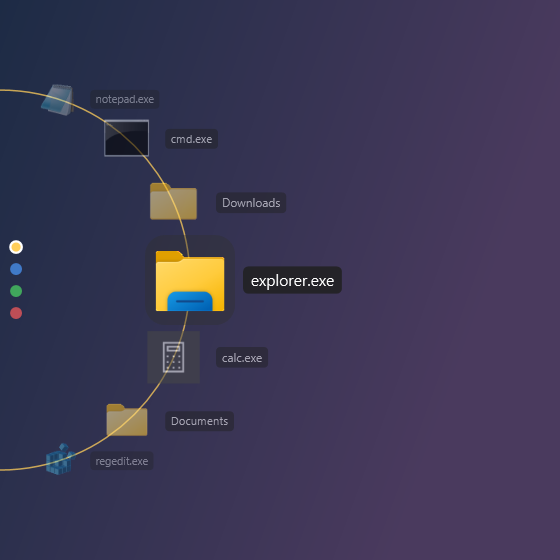
  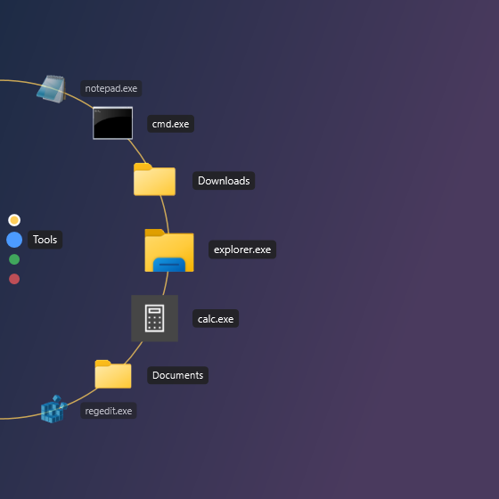
  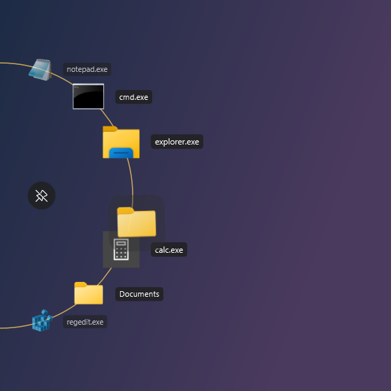
  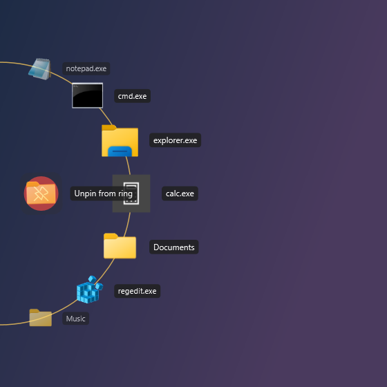
  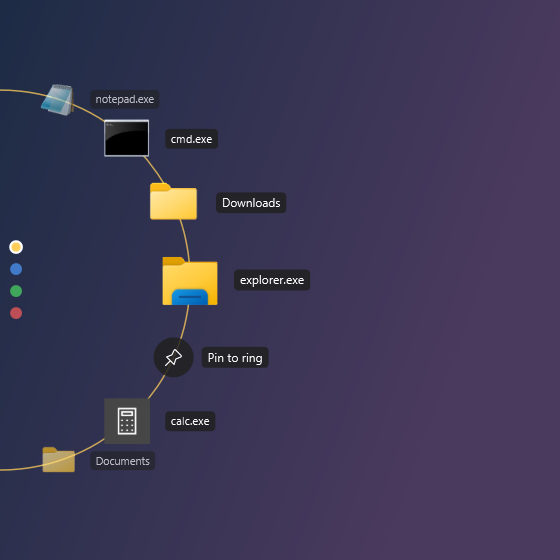
  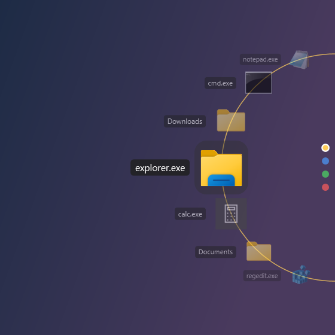
</p>

<p align="center">
  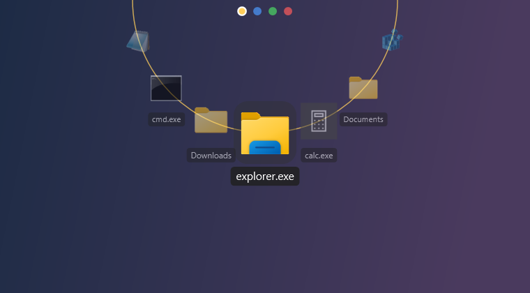
</p>

## Settings

<p>
  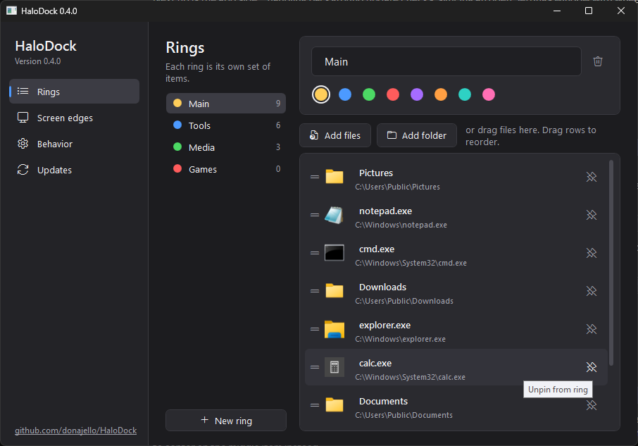
  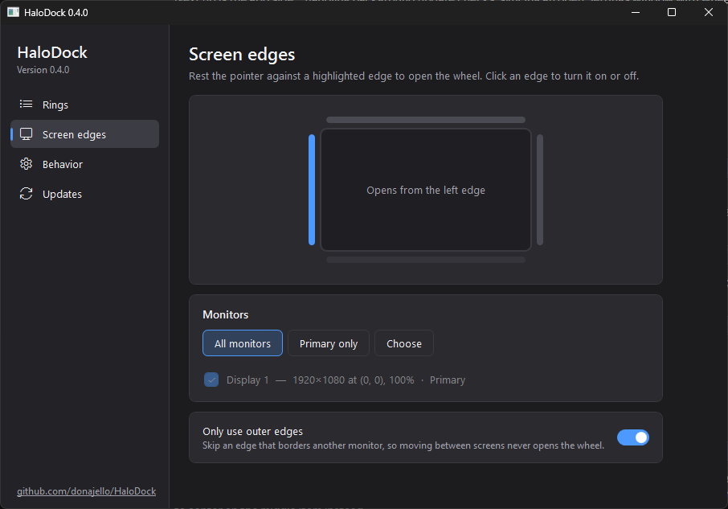
  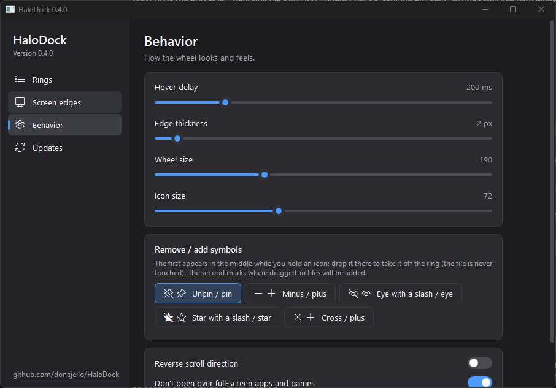
  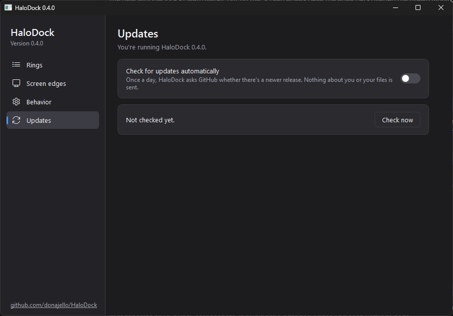
</p>

Changes apply as you make them. There's no Save button.

## Install

Download `HaloDock.exe` from the [latest release](../../releases/latest). It's a standalone build for 64-bit Windows 10/11 and runs without anything else installed. Run it and it sits in the system tray: left-click the tray icon for Settings, right-click for Pause, Check for updates and Exit. Settings has an option to start HaloDock when you sign in.

Windows SmartScreen may warn the first time, since the exe isn't code-signed. Choose **More info → Run anyway**.

## Using it

| Action | What happens |
| --- | --- |
| Rest the pointer on an enabled edge | Wheel opens |
| Scroll over the icons | Turn the wheel |
| Scroll just inside the icons, or click a dot | Switch ring |
| Left-click an icon | Open it |
| Right-click an icon | Windows context menu, plus **Unpin from ring** |
| Hold an icon, or press and drag it | Pick it up; the others part to show where it'll land. Let go off the ring to cancel |
| Drop a held icon on the unpin symbol in the middle | Take it off the ring (the file isn't touched) |
| Drag files into a gap between icons | Pin them to the ring there |
| Drag files onto a folder or app icon | Move or copy into the folder, or open with the app |
| Move away | Wheel closes |

Settings are stored in `%AppData%\HaloDock\settings.json`.

## Updates

Updates are off until you turn them on in **Settings → Updates**. When they're on, HaloDock asks the GitHub API once a day whether there's a newer release. Nothing about you or your files is sent. If there is one, you get a notification, and **Download and install** fetches the new `HaloDock.exe`, swaps it in, and restarts. You can also check by hand at any time.

## Building

Requires the .NET 9 SDK on Windows.

```bash
dotnet run
```

Standalone release build:

```bash
dotnet publish -c Release -r win-x64 --self-contained true -p:PublishSingleFile=true -p:IncludeNativeLibrariesForSelfExtract=true -p:EnableCompressionInSingleFile=true
```

The screenshots and demo are rendered by the app itself, without touching the screen:

- `HaloDock.exe --snapshot out.png [hoverIndex] [--edge Left|Right|Top] [paths…]` renders the wheel. A `hoverIndex` of `-2`, `-3`, … hovers a ring dot; `100+N` holds item N over a gap; `200+N` holds it over the unpin target; `300+N` shows a file being dragged in.
- `HaloDock.exe --snapshot-settings out.png --page rings|edges|behavior|updates` captures a Settings page.
- `HaloDock.exe --demo frames-folder` renders the demo walkthrough as numbered PNG frames, which [ffmpeg](https://ffmpeg.org/) turns into `docs/demo.mp4` and `docs/demo.gif`.

## Notes

- Dark right-click menus use the same undocumented Windows switch Explorer and Notepad++ rely on. On Windows versions without it, those menus simply stay light.
- The right-click menu is the classic full menu (Windows 11's "Show more options" menu), since the compact Windows 11 menu isn't available to other apps.
- Self-updating only works for the downloaded `HaloDock.exe`. A build run from source just links to the release page.
