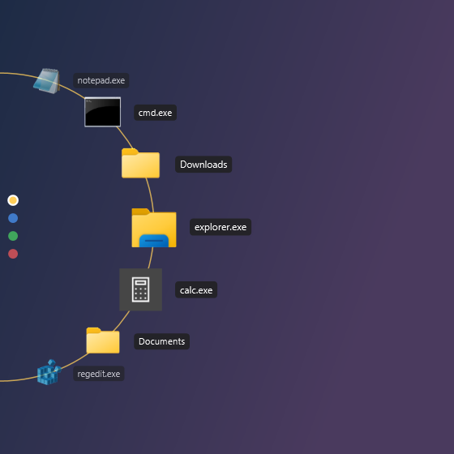
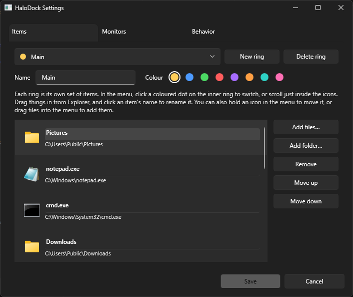

# HaloDock

A radial launcher for Windows that pops out of the left edge of your screen. Rest your pointer against the edge and your files, folders and apps fan out in a half-wheel; scroll to turn it, click to open.

<p>
  
  
  
  
  
  
</p>

## Features

- **Edge-activated wheel.** Rest the pointer on the left edge for a moment and the wheel opens at that height. Move away and it closes.
- **Real Windows icons.** Every item shows the same icon Explorer would.
- **Scroll to turn.** The mouse wheel spins the ring and doesn't scroll the window underneath.
- **Rings.** Save several sets of items, each with its own colour. Switch between them with the coloured dots on the inner ring, by clicking a dot or by scrolling just inside the icons.
- **Arrange it like a phone home screen.** Long-press an icon to pick it up and drop it where you want it; the other icons slide out of the way. Drag files from Explorer into a gap to add them.
- **Drag and drop.** Drag files to the edge and drop them on a folder to move or copy them there (Explorer rules, with Ctrl to copy and Shift to move), or on an app to open them with it.
- **The normal right-click menu.** Right-click an icon for Explorer's own context menu: Open with, Send to, Properties, and so on.
- **Multi-monitor aware.** Choose all monitors, the primary only, or specific ones. Edges shared between two screens are ignored by default so moving between monitors never pops the menu. Works across monitors with different scale factors.
- **Follows your theme.** Light or dark, matching Windows, including the right-click and tray menus.
- **Stays out of the way.** It doesn't open over full-screen apps or games, or while you're dragging a window to snap it.



## Install

Download `HaloDock.exe` from the [latest release](../../releases/latest). It's a standalone build for 64-bit Windows 10/11 and runs without anything else installed. Run it and it sits in the system tray. Left-click the tray icon for settings; right-click for Pause and Exit. Settings has an option to start HaloDock when you sign in.

Windows SmartScreen may warn the first time, since the exe isn't code-signed. Choose **More info → Run anyway**.

## Using it

| Action | What happens |
| --- | --- |
| Rest the pointer on the left edge | Wheel opens |
| Scroll over the icons | Turn the wheel |
| Scroll just inside the icons, or click a dot | Switch ring |
| Left-click an icon | Open it |
| Right-click an icon | Windows context menu, plus **Remove from ring** |
| Hold an icon, or press and drag it | Pick it up; the others part to show where it'll land. Let go off the ring to cancel |
| Drop a held icon on the unpin symbol in the middle | Take it off the ring (the file isn't touched) |
| Drag files into a gap between icons | Pin them to the ring there (a pin marks the spot). The unpin/pin symbols can be changed in Settings |
| Drag files onto a folder or app icon | Move or copy into the folder, or open with the app |
| Move away | Wheel closes |

Settings are stored in `%AppData%\HaloDock\settings.json`.

## Building

Requires the .NET 9 SDK on Windows.

```bash
dotnet run
```

Release builds:

```bash
dotnet publish -c Release -r win-x64 --self-contained false -p:PublishSingleFile=true
```

```bash
dotnet publish -c Release -r win-x64 --self-contained true -p:PublishSingleFile=true -p:IncludeNativeLibrariesForSelfExtract=true -p:EnableCompressionInSingleFile=true
```

For working on the look, `HaloDock.exe --snapshot out.png [hoverIndex] [paths…]` renders the wheel to an image without opening it on screen. A `hoverIndex` of `-2`, `-3`, … hovers a ring dot instead of an item.

## Notes

- Dark right-click menus use the same undocumented Windows switch Explorer and Notepad++ rely on. On Windows versions without it, those menus simply stay light.
- The right-click menu is the classic full menu (Windows 11's "Show more options" menu), since the compact Windows 11 menu isn't available to other apps.
